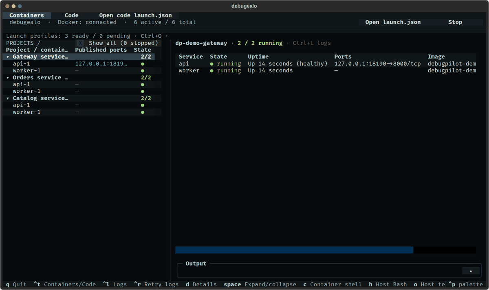
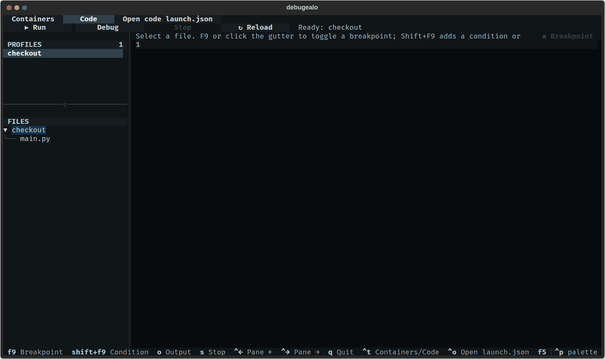

<h1 align="center">debugealo</h1>

<p align="center">
  <strong>Local-first Docker debugging, right in your terminal.</strong><br>
  Watch your containers, run Compose safely, and step through Python, Go and Node code<br>
  from one keyboard-driven dashboard. No cloud, no IDE required.
</p>

<p align="center">
  
  
  
  
</p>

---

<p align="center">
  
</p>

<p align="center">
  
</p>

## Quick start

```console
curl -LsSf https://astral.sh/uv/install.sh | sh                        # 1. install uv (once)
uv tool install git+https://github.com/carlosrivas2021/debuguealo.git   # 2. install debugealo
debugealo doctor                                                        # 3. check Docker access
debugealo                                                               # 4. open the dashboard
```

To update, rerun the install command with `--reinstall`. The dashboard tells you when a newer
release exists: at most once a day it reads the repository's release tags with
`git ls-remote`, using your existing git credentials and never prompting for them. Offline or
without access it stays silent; set `DEBUGEALO_NO_UPDATE_CHECK=1` to turn the check off.

uv downloads a suitable Python if you don't have one. Docker is the only other requirement.
Debugging Go also needs [Delve](docs/go-debugging.md):
`go install github.com/go-delve/delve/cmd/dlv@latest`.

## What you get

| | Feature | In short |
|---|---|---|
| 🐳 | **Containers** | Running and stopped containers grouped by Compose project, with live CPU and memory, health, restart policy, mounts and exit codes, and historical and live logs that reconnect when containers change. |
| 🚀 | **Launch profiles** | Save your Compose setups once in a central `launch.json`, then run **Play / Recreate** or **Build + Recreate** with an inline confirmation. |
| 🐞 | **Debugging** | Breakpoints, conditional breakpoints, hit counts, logpoints, watch expressions, stepping, stack/variable inspection, nested variables and changing variables while paused for **Python**, **Go** and server-side **Node**. |
| 🔌 | **Attach** | Connect to an existing loopback `debugpy`, Delve or Node Inspector target, for example inside a container, without taking over its lifecycle. |
| 💻 | **Terminals** | A container shell and a host Bash docked inside the dashboard. |
| 🛡️ | **Safe by default** | Destructive actions ask first, image downloads need consent, and debug ports listen on `127.0.0.1` only. |

## Keyboard cheat sheet

**Everywhere**

| Key | Action |
|---|---|
| `Ctrl+T` | Switch between **Containers** and **Code** |
| `Ctrl+O` | Edit `launch.json` in the built-in editor (`Ctrl+S` saves, `Esc` closes) |
| `/` | Filter the list: projects and containers, or Code profiles (`Enter` keeps it, `Esc` clears it) |
| `Ctrl+Left` / `Ctrl+Right` | Move focus between panes (`Alt+Left` / `Alt+Right` too, for macOS) |
| Drag with the mouse | Copy the selected text (whole rows in container logs) |

**Containers**

| Key | Action |
|---|---|
| `r` | Preview **Play / Recreate** |
| `Shift+R` | Preview **Build + Recreate** |
| `s` | Stop the selected container or project, after confirmation |
| `Shift+A` | Edit the AWS config and credentials files side by side |
| `Ctrl+L` | Open logs (`D` or `Esc` closes them, `Ctrl+R` reconnects) |
| `C` / `H` | Open the container shell / host Bash |
| `O` | Show or hide the output console |
| `Space` | Collapse or expand a group |

**Code**

| Key | Action |
|---|---|
| `F5` | Run the profile, or **Continue** while paused |
| `Shift+F5` | Debug the profile |
| `F9` / `Shift+F9` | Toggle a breakpoint / add a condition, logpoint or hit count |
| `F10` / `F11` / `Shift+F11` | Step over / in / out |
| `Enter` on a variable | Change its value while paused |
| `Space` or `Right` / `Left` on a variable | Expand / collapse its fields |
| `S` | Stop the selected run |
| `R` | Restart the running profile, or reload `launch.json` when it is stopped |
| `P` | Go to the running program's input (**Esc** returns to the profiles) |

The full workflow is in the [keyboard guide](docs/tui.md).

## Command line

```console
debugealo                      # open the dashboard (same as `debugealo tui`)
debugealo doctor               # check Python, config, Docker access and Delve
debugealo containers [--json]  # list containers
debugealo logs <name> --tail 100 [--follow]
debugealo version
```

`doctor` exits with `0` when every check passes, `1` when Docker is unavailable or access is
denied, and `2` for invalid configuration. A missing Delve is only a warning.

## Try it

| Example | What it shows |
|---|---|
| [`examples/fastapi-debug`](examples/fastapi-debug/README.md) | Attach to a Python `debugpy` target running in a container |
| [`examples/multi-project`](examples/multi-project/README.md) | Three independent Compose projects that share a network |

## Documentation

| Start here | Go deeper |
|---|---|
| [Keyboard workflow](docs/tui.md) | [Architecture](docs/architecture.md) |
| [Launch profiles](docs/launch-profiles.md) | [Docker integration and limits](docs/docker.md) |
| [Code projects and debugging](docs/code-projects.md) | [Configuration](docs/configuration.md) |
| [Compose safety and limits](docs/compose.md) | [Python](docs/python-debugging.md) · [Go](docs/go-debugging.md) debugging |
| [Container controls](docs/container-controls.md) | [Multi-project setups](docs/multi-project.md) · [Terminal](docs/terminal.md) |

## Platform notes

- **Linux:** use Docker Engine and grant your account socket access according to your
  organization's policy.
- **macOS:** use Docker Desktop.
- **Windows:** use PowerShell and Docker Desktop in Linux-container mode. Windows has not been
  rechecked since the Python attach and F5/F9 changes.

> [!WARNING]
> Docker access is privileged. Do not expose its socket, make it world-writable, or run
> debugealo as administrator to work around configuration errors.

After installation, debugealo works offline. Installing dependencies and building the example
images may download packages.

## Development

```console
uv sync --locked
uv run debugealo
uv run pytest -m "not integration" -n auto   # unit tests, in parallel on every core
uv run pytest                                # full suite: needs Docker, and Delve as `dlv`
uv run ruff check . && uv run ruff format --check .
```

The Go debugging tests fail rather than skip when Delve is missing.

### Releasing

Versions are managed by [release-please](https://github.com/googleapis/release-please) from
Conventional Commits: `fix:` bumps the patch, `feat:` the minor, and a breaking change the
major (the minor while below 1.0). Every push to `main` keeps a release PR up to date with the next
version and `CHANGELOG.md`; merging it tags `vX.Y.Z` and publishes a GitHub Release. Never edit
the version by hand — `pyproject.toml` is the single source and `debugealo version` reads it
from the installed package. The repository must allow GitHub Actions to create pull requests
(Settings → Actions → General → Workflow permissions).

<details>
<summary><strong>Coming from <code>debugpilot</code>?</strong></summary>

The distribution, package and command are now named `debugealo`. `python -m debugpilot` and
`debugpilot.*` imports still work, but the `debugpilot` command is no longer installed.
Configuration, profiles and breakpoints stay where they were, so nothing needs migrating.
To update an existing checkout:

```console
uv sync --inexact --frozen --reinstall-package debugealo
```

</details>

## License

[MIT](LICENSE)
