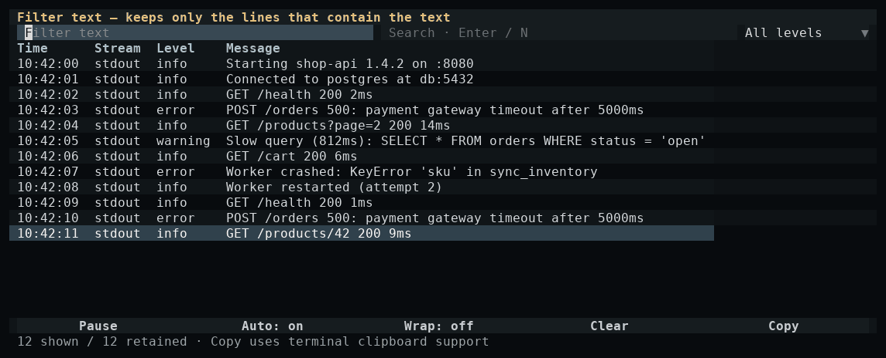

# Terminal dashboard

Run `uv run debugealo` or `uv run debugealo tui` to open the local Docker dashboard.
Use `uv run debugealo tui --config path/to/config.toml` for explicit settings. Docker
connection status is shown separately from saved launch configuration state.

The dashboard presents saved profiles, their containers, and unowned Docker inventory
in one scrollable project tree on the left, with logs and selected-container details in the main pane,
and Compose execution output in a separate docked console. The same persistent dock
contains the Host Bash PTY pane; the container shell occupies the right-hand logs area.
Mounting either pane never starts a shell. Native Textual
widgets use the existing near-black palette, muted separators, compact controls, and
visible keyboard focus. Sidebar, logs, Compose output, and terminal remain separate.
Unchanged inventory refreshes preserve the tree's scroll position and selection;
changes to displayed ports, state, or rows still update the inventory.
Column widths account for cell padding and vertical-scrollbar space, including after resize.
The sidebar reserves its scrollbar gutter so scrolling does not shrink the tree's viewport.
On desktop terminals the 48-column sidebar prioritizes project/service names over
port and state columns. Narrow terminals retain the stacked layout.

Text filter, search, and severity share one compact toolbar. Search still supports
Ctrl+F, Enter, and N; filtering and log ingestion are unchanged. Table headers,
selection, controls, and footer use the existing dark project palette.
The lower console starts completely hidden, leaving all rows available to the dashboard.
Press `O` from the project tree to show it. When shown, the Compose console displays an
empty-state hint until a real execution produces output.
Inactive terminal panes occupy no rows. `C` replaces the right-hand logs with the
selected container's shell without opening the lower console; `H` shows Host Bash below.
Only one session is active: switching between C/H closes the previous session first.
Press `O` or **Hide output · O** to hide the entire console and return all its rows to
the dashboard. Focus returns to the project tree; press `O` there to restore the dock.
Hiding does not clear output or close an active session. Explicitly opening a terminal
with `H` also reveals the console. `O` does not hide the right-hand container shell.

## Containers / Code

Use the top **Containers** and **Code** buttons, or `Ctrl+T`, to switch without
starting or stopping processes. `Ctrl+T` is unavailable while a modal is open or a
terminal pane has focus (press `Esc` first). Code lists registered project folders and command arguments; container
shortcuts are inactive there. Ctrl+O edits the active area's launch file.
**Open code launch.json** opens the separate central code configuration directly.
In Code, **Ctrl+Left** and **Ctrl+Right** move focus between the profiles, the file tree and
the source, in screen order; **Alt+Left** and **Alt+Right** do the same. **F5** or **▶ Run** runs the selected profile without debug; focus stays on the profiles. Click its
terminal to type; **Escape** returns focus to profiles and **O** hides or shows it. **S** or **Stop** ends only the selected Code
context. **R** restarts the selected profile while it runs or debugs; when it is stopped, **R** or
**↻ Reload** rereads the code `launch.json`. A running profile survives area changes; repeated F5 does not restart it. Distinct
profiles may run/debug/attach concurrently, with one live session per saved profile; selecting
an active profile returns to its context. Same-endpoint attaches are rejected, while distinct
endpoints may coexist. **Shift+F5** or **Debug** starts Python debugging from that same profile
and its requested source breakpoints, which **F9** toggles at the source cursor. **Shift+F9**
adds a condition, a log message (logpoint) or a hit count to the line; see
[conditional breakpoints and logpoints](code-projects.md#conditional-breakpoints-and-logpoints). The debug panel's **Watch** section re-evaluates
expressions on every pause; see [watch expressions](code-projects.md#watch-expressions). At a pause, inspect the stack/variables and the
yellow-shaded execution line, then use **F5** or **▶ Continue**, **F10** (over), **F11** (in), or
**Shift+F11** (out). F5 continues only the paused profile under the cursor. Stop cancels startup or ends the
active Code run/debug tree. Debug output is internal-console only (no interactive stdin).
Missing debugpy or unsupported commands report an error without falling back to run.
See [code project execution and debugging](code-projects.md) for setup and limits.

## Launch profiles

The primary sidebar lists saved profiles from the central user-configuration
`launch.json`, using each profile's `name`. A valid inactive profile shows `Stop` as its
available group action; active profiles show their active count, and invalid profiles
remain `Pending`. Central profiles require their own explicit
`workspaceFolder` root. Explicit local-workspace callers retain the
`.debugpilot/launch.json` compatibility location. If none are saved, choose
**Open launch.json** to create or edit that file in an editor. Opening the file is
explicit; startup and Docker inventory refresh never create or rewrite it.

Choose a profile and use **Play / Recreate** to apply its Compose files, or **Build +
Recreate** when code changed. Both actions require confirmation. `r` previews Play /
Recreate; `Shift+R` previews Build + Recreate. There is no plain Restart action in the
TUI. `Ctrl+O` opens `launch.json` directly in debugealo's built-in editor; it never opens
a Compose file picker or starts a service, and no external editor is needed. **Ctrl+S**
saves: valid JSON is formatted with two-space indentation while preserving field order and
unknown fields. Invalid JSON is not saved; the editor stays open with your text and reports
the line and column. Duplicate object keys and nonstandard numeric constants are rejected
the same way, and so is formatted output over the 256 KiB launch-file limit. Saving replaces
the file atomically and is refused if the file changed on disk since it was opened, so
another program's save is never lost. **Esc** closes the editor; with unsaved changes it
warns first, and a second **Esc** discards them. The launch profiles are reloaded after a
save. While the editor is open, the dashboard's shortcuts do nothing. Launch profiles
may also declare per-service direct environment and published-port overrides; see
[launch profile overrides](launch-profiles.md#direct-service-environment-and-port-overrides).

The profile's display `name` is for people. Containers link by the configured Compose
`projectName` label, so profiles can have names different from their Docker projects.
Each saved profile row contains indented, selectable children for its matching actual
containers. Profiles remain listed when they have no matching containers. When two
profiles share a Compose project, each retains its own child rows. Selecting a profile
shows the project overview; selecting a child shows that container's details and Stop
acts on that actual container. `Ctrl+L` opens logs for either selection. A child appears under its owning profile and is not
repeated in the unowned groups of the same tree. Press `Space` on a profile or project
group to collapse or expand its children; selection stays on that group. `r` previews Recreate and `Shift+R` previews
Build + Recreate for the selected saved profile; both preserve confirmation and target
pinning. Redundant sidebar Play/Recreate buttons are hidden. Incomplete or invalid
profiles remain visible as pending and must be fixed in `launch.json` before they can run.

## Active containers and logs

The same **Projects / containers** tree also shows actual Docker inventory not owned
by any saved profile, grouped by Compose project or under a standalone group. It displays assigned `public_port` bindings (including bracketed IPv6 host
addresses), not private-only exposed ports. **Show all** reveals stopped containers
under their owning profiles and unowned groups without creating another inventory table.
Group stop actions use the visible project's active members; hidden siblings are not
silently included.

Selecting a container shows four detail cards built from the inventory: **Status**
(state, Docker uptime, creation date, CPU, memory), **Image** (name, image, short ID),
**Network** (published ports) and **Compose** (project, service, project folder). Selecting a
project or saved profile shows an overview table of every project container, stopped
ones included, with state, uptime, ports and image. Neither view opens a log stream.

For a running container, **CPU** and **Memory** update live while its card is shown.
debugealo asks Docker for one stats sample per refresh interval (2 seconds by default),
only for that container and through the worker that already reads the inventory: no
stats stream and no extra process. CPU shows `—` until a second sample arrives, because
it is computed between two samples; 100% means one full CPU, as in `docker stats`.
Memory excludes reclaimable page cache, also like `docker stats`, and shows the limit
when Docker reports one. Sampling stops when you select another row, open the logs or
quit; stopped containers and project overviews are never sampled.

**Ctrl+Left** and **Ctrl+Right** move focus between the list and the view on the right that
can take it: the open logs or a project's overview table. They wrap around, and do nothing
while only a container's detail cards are shown. In the log filter and search fields they
keep moving the cursor by word.

**Alt+Left** and **Alt+Right** (Option+arrows on a Mac) do the same, because macOS uses
Ctrl+arrows to switch spaces by default. In the log filter and search fields they do nothing,
so typing never moves focus away.

Logs open only on request: `Ctrl+L` follows the selected container, or the combined
logs of the project's active containers. `D` or `Esc` closes the logs and returns to the
details, and selecting another row closes them too. Selecting a saved profile links log
selection to active containers with the matching `projectName`; it does not rename them
to the profile's display name. Open logs survive inventory reorder, refresh and state
changes of the same row; if a target disappears, an unrelated stream is not opened
automatically.

| Control | Effect |
| --- | --- |
| `r` | Preview Recreate for the selected saved launch profile. |
| `Shift+R` | Preview Build + Recreate for the selected saved launch profile. |
| `s` | Confirm stopping the selected visible container or project group. |
| `a` | Refresh AWS credentials for every profile with `awsCredentials`, then offer Recreate for the running ones. |
| `Shift+A` | Edit the AWS config and credentials files side by side in the built-in editor (also from Code). |
| `C` | From the project tree, show `/bin/sh` for the selected running container in the logs area. |
| `H` | With the project tree focused, open host Bash in the explicit local workspace or the selected central profile's validated working directory. |
| `D` | Close open logs and show details for the selected container. |
| `Esc` | In the terminal, return focus to the current left table; otherwise close open logs or cancel a pending confirmation. |
| `O` | Hide/show the entire docked console; when hidden, restore it from the project tree with `O`. |
| `Ctrl+O` | Edit the central (or explicitly selected local) `launch.json` in the built-in editor. |
| `Ctrl+L` | From outside a focused shell, open and focus logs for the current selection. |
| `Ctrl+T` | Switch between the Containers and Code areas. |
| `Ctrl+R` | Retry the selected log stream after EOF or an error. |
| `q` | Exit. |

`C` pins the currently selected running container (including a profile child) and uses the
configured Docker endpoint, or the existing platform default. With an explicit local
workspace, both terminals keep using that canonical workspace. In central-profile mode,
both use the selected profile's working directory, resolved by the same workspace/path
validation as Compose. `H` requires no container selection. Missing or invalid profile
contexts are refused; no arbitrary current-directory fallback is used.
Both require a focused project tree; invalid workspace/target contexts are refused.
Startup failures appear in the corresponding terminal area. There is no PowerShell fallback. Once a terminal
is focused, typed keys and control keys—including `Q`, `D`, `S`, `R`, and `O`—belong to
the shell; `Ctrl+C` is sent to it and `Esc` returns focus to the left table. To copy output,
drag over it with the mouse: releasing the button copies the selection and shows
**Copied N characters**. This works anywhere text can be selected, including logs, detail
cards, the Code run terminal and the debug output, and it replaces what the clipboard held.
With text selected in a terminal, `Ctrl+C` copies it again and the process keeps running;
without a selection, `Ctrl+C` interrupts the process as usual. The terminal
keeps its opened target when inventory selection changes and is never reopened by refresh.
For C, **Logs** (or Esc, then Ctrl+L) returns to logs without ending the shell.
Press C on the same selected target to restore that pinned session; changing selection
alone never retargets it. Both terminal areas offer **Close terminal** to end the session
or cancel a pending startup; closing C restores the details (or the logs, if they were open). Switching views joins prior cleanup,
including when a pending switch is cancelled. Startup runs
outside the app message handler so the close control remains responsive; close and app
shutdown cancel and join any pending opening task before releasing the session.
No real shell is started by app startup,
widget construction, inventory refresh, or the Compose-output toggle.

Recreate and Build + Recreate interrupt running services. They use explicit profile
files and never interpret shell command strings or shell variables. Compose execution
output streams literally to the dedicated Compose console, with start and exit
summaries even when the CLI emits no output. The latest operation output is retained in
memory with its project/profile identity and restored after same-profile refresh; it is
not shown when another project/profile is selected, is not persisted, and does not
fabricate application logs. A concrete Docker `No such image` diagnostic offers inline
**Download and retry** and **Cancel** controls. Cancel is the safe default, including
Enter while Cancel is focused; only explicit Download consent retries the original
pinned action once for that selected profile. Other failures show their output without
a download option. Closing, cancelling, refreshing, or changing the profile never
implicitly grants consent. The transcript stays separate from application logs, retains
the latest operation for the selected profile in memory, and can be hidden/restored
without clearing it. See [Compose safety and limits](compose.md) and
[container stop](container-controls.md).

## Filter and search logs

**Filter text** keeps only the lines that contain the text and hides the rest. **Search**
keeps every line, highlights the matches and jumps to the next one with **Enter** or **N**,
turning auto-scroll off so the match stays in view. Filter to focus on what matters; search to
find something without losing the lines around it. Both combine with the level selector.

  

## Log display limits

The in-memory log buffer is limited to 2,000 entries and 2 MiB. Pausing can lose older
entries when those limits are reached. Copy depends on terminal clipboard support.

To copy logs, drag over rows with the mouse: the rows you cover are highlighted, and
releasing copies those whole lines, each as `time [stream] message`. A click without moving
only selects a row, and **Copy** or **Ctrl+Y** copies the selected one. New lines wait until
you release, so rows never shift under the mouse. Parts of a line cannot be selected.

**Wrap** (or **W** in the table) shows long messages on several lines, using the
width left after the time, stream and level columns; turn it off to keep one line per entry.

## Not implemented yet

Code supports read-only source navigation, persistent root-scoped requested breakpoints,
Python/Node/Go debugging, and non-owning Go, Python and Node attach. Distinct saved profiles retain separate
run/debug/attach contexts; the same endpoint cannot be attached twice. Expression
evaluation and a desktop editor are not implemented. See [Code setup and limits](code-projects.md).
